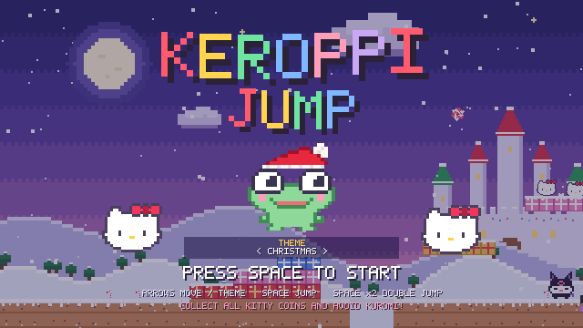
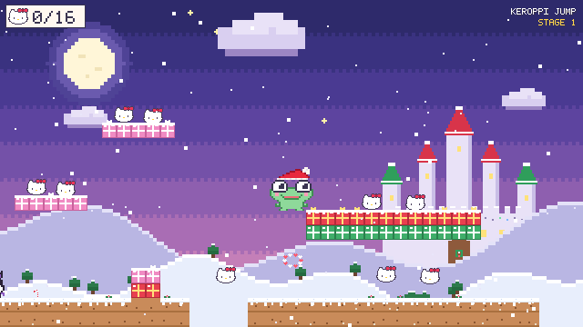
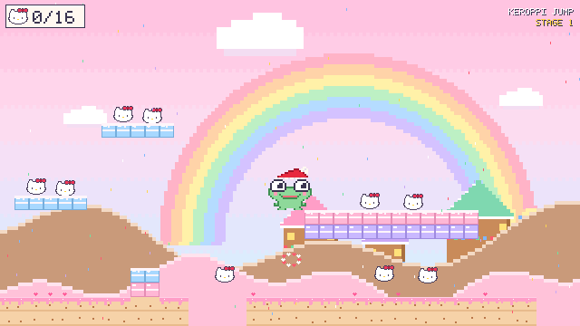
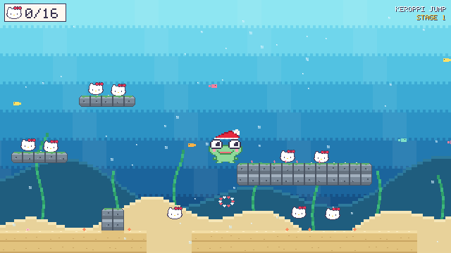

# 🐸 KEROPPI JUMP

A single-file pixel-art platformer built with pure HTML5 Canvas and vanilla JS (`frontend/index.html`).
Santa-hat Keroppi collects Hello Kitty coins, dodges patrolling Kuromi, and races to the flag across 5 stages.
Deployed to a private S3 bucket behind CloudFront (OAC) with AWS CDK (TypeScript).

> Personal / non-commercial fan project. Sanrio characters (Keroppi, Hello Kitty, Kuromi) belong to Sanrio.



*Demo (about 19s): title fireworks → theme browsing → READY/GO → stage 1 with double jumps, a Kuromi stomp and coins → STAGE 1 CLEAR.*

## Themes

Pick a theme on the title screen with **← / →**. The theme also sets the difficulty (Kuromi speed).

| 🎄 Christmas (normal) | 🍪 Cookie Town (hard, x1.2) | 🌊 Under the Sea (hardest, x1.45) |
|---|---|---|
|  |  |  |
| Night sky, moon, snowy castle, Christmas tree, falling snow. Snow-frosted gingerbread ground, gift-box blocks | Pastel sky, rainbow, gingerbread houses, giant lollipops, sprinkles. Strawberry-cream cookies, macaron blocks | Light rays, swaying kelp, fish, rising bubbles. Sandy floor with shells & starfish, mossy boulder steps |

## How to play

| Key | Action |
|---|---|
| ← → | Move (on the title screen: choose theme) |
| Space | Jump · press again in the air for a **double jump** |
| Space / Enter | Start (title) · skip to next stage (clear screen) |
| R | Restart current stage (after ALL CLEAR: back to stage 1) |

- **Hello Kitty coins**: count shown top-left. Collect them all for **PERFECT!**
- **Kuromi**: patrols and turns at walls/ledges. Touch = **GAME OVER**, stomp on the head = defeat (bounce).
- **Pits**: falling sends you back to the start of the stage (coins kept).
- **Flag**: clears the stage (coins not required), auto-advances to the next stage after 2.5s. Stage 5 → **ALL CLEAR!**
- Engine: fixed 1/60s physics step with render interpolation, axis-separated AABB tile collision, coyote time 0.1s, jump buffer 0.1s, variable jump height.

## Run locally

```bash
python3 -m http.server 8765 -d frontend
# open http://localhost:8765
```

No build step and no external libraries; opening `frontend/index.html` directly also works.

## Deploy (AWS CDK)

```bash
npm install
npm run build && npm test     # type-check + stack assertions (private bucket, SSL-only, OAC, invalidation)
npx cdk deploy                # outputs GameUrl = https://<id>.cloudfront.net
npx cdk destroy               # removes bucket (auto-deletes objects) and distribution
```

Stack (`lib/clawd-jump-stack.ts`): S3 bucket (block all public access, enforce SSL, `DESTROY` + `autoDeleteObjects`) →
CloudFront `Distribution` with `S3BucketOrigin.withOriginAccessControl`, HTTPS redirect, `index.html` root →
`BucketDeployment` with `/*` invalidation → `GameUrl` output.

## Project layout

```
frontend/index.html          the whole game (engine, levels, art, themes, HUD)
lib/clawd-jump-stack.ts      CDK stack: S3 + CloudFront (OAC) + BucketDeployment
bin/clawd-jump.ts            CDK app entry
test/clawd-jump.test.ts      CDK template assertions
docs/superpowers/            design spec and implementation plan
docs/images/                 screenshots
```
